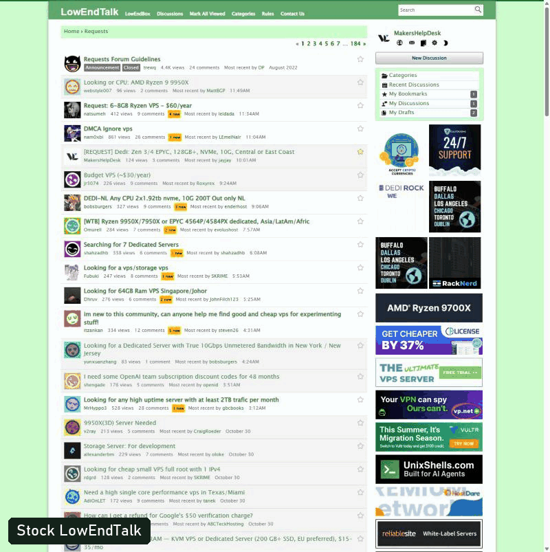
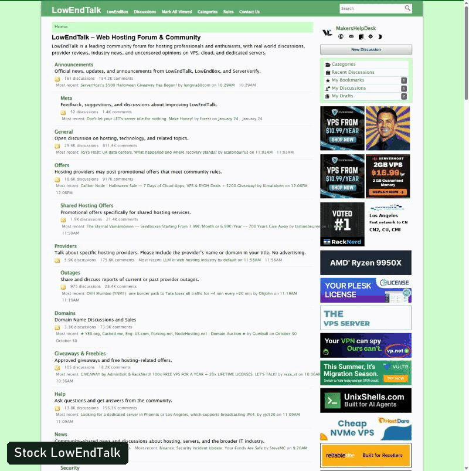
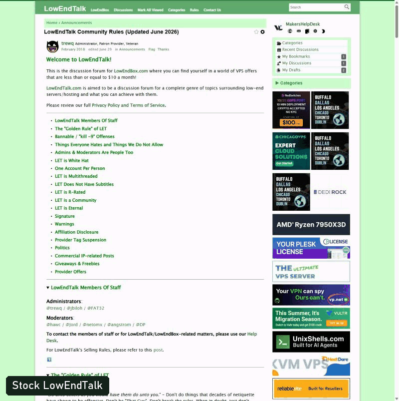

  

<h1 align="center">BetterLET</h1>

  <strong>LowEndTalk, rebuilt in your browser.</strong> 
  A Chrome extension that gives the forum a real layout, real scanning, and two real themes. 
  <strong>Not an ad blocker. Ads pay for LET and LEB, so they stay.</strong>

  

## Before and after

### Thread list

From a loose list of green links to a rack you can scan in seconds.

### Categories

Every category in one tight rack, with counts and the latest post lined up.

### Reading a thread

Wider layout, better type, and your menus stay within reach.

## What you get

### Scan faster

- **Status lights.** Lit means you have not opened it, or it has new replies. Hollow means you are caught up.
- **Three-line rows.** Title, then category and author, then last comment with its date and time.
- **Two ways in.** The title opens the first post. The date and arrow jump to the last comment, with the whole post in view.
- **Sort your way.** Newest reply, newest thread, oldest thread, or most replies.
- **Hide seen.** Clears threads you have opened. Your own threads always stay.
- **Hide pinned**, **Mark all seen**, and **Load next page** without leaving the list.

### Know before you click

- **User hover cards.** Roles, join date, last active, threads, comments, and thanks.
- **Link previews.** Image, title, description, and the real domain.
- **Safety check.** Every previewed link is checked against Cloudflare's security DNS. Flagged sites are never fetched.
- **Link text check.** Warns when the text of a link names a different site than its target.

### A forum that fits your screen

- **Left sidebar.** Account, Quick Links, and Categories stay in reach and do not get dragged around.
- **Works on old hardware.** Layouts for wide screens, older laptops, small windows, and phones.
- **No sideways scrolling.** Columns drop as space runs out. Ads never shrink.
- **Auto, Light, and Dark.** Auto follows your system.

### The details

- New pop-out menus, Phosphor icons, and a calm spinner that shows only on slow loads.
- Rebuilt Categories, Profile, and all six settings pages.
- Signatures and long "Thanked by" lists stay closed until you want them.
- Mark All Viewed asks first.

## V1 and V2

A switch in the header flips between two designs, so you can compare them on real pages.

| | V1: The Rack | V2: LowEndBox |
|---|---|---|
| **Look** | Server rack rails, status lights, glass header | Matches LowEndBox: white page, mint frame, thin borders |
| **Type** | Bahnschrift and Segoe UI | General Sans at 16px |
| **Corners** | Soft | Square |

Both run on the same code, so every feature works in both.

## No, we are not blocking the ads

Ads are how LowEndTalk and LowEndBox stay online. We use this forum every day, so we want it to keep running.

BetterLET has a hard rule: it never hides, shrinks, or covers an ad.

- The ad column keeps its full size and its full stack.
- The header stops before the ads, and hover cards stop at the ad column.
- On narrow screens, ads move below the threads at full size.

If you want an ad blocker, this is the wrong extension.

## Install

1. Download this repo.
2. Open `chrome://extensions`.
3. Turn on **Developer mode**.
4. Click **Load unpacked** and pick the folder with `manifest.json`.
5. Open [LowEndTalk](https://lowendtalk.com/categories/requests).

To update, pull the latest code and click reload on the BetterLET card.

## Privacy

- Your seen threads and settings stay in your browser.
- Hovering a link sends its domain to Cloudflare, then contacts that site from your IP to read its preview. No cookies are sent.
- V2 loads its font from Fontshare.

## How it is built

Plain JavaScript and CSS, with no build step, so it stays fast and does not fight the forum's own scripts.

| File | Job |
|---|---|
| `early.js` | Sets the theme before the page paints |
| `styles.css` | All tokens, layouts, V1, and V2 |
| `content.js` | Sidebar, rows, sorting, and page rebuilds |
| `popovers.js` | User and link hover cards |
| `background.js` | Fetches link previews and safety checks |
| `tools/icons.py` | Pulls Phosphor icons into `styles.css` |
| `docs/SITE-MAP.md` | Map of the forum's pages and markup |
| `DESIGN.md` | The design rules. Read this before changing anything visual |

## Status

Built for personal use. V1 and V2 are both on trial.
