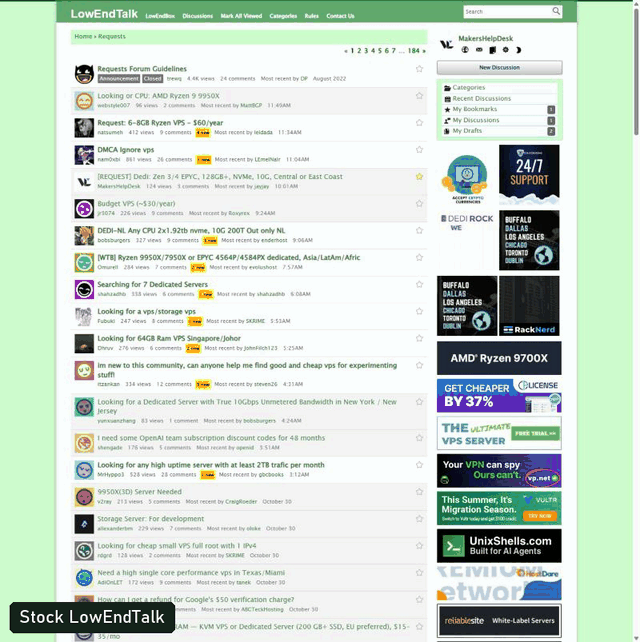

  

<h1 align="center">BetterLET</h1>

  <strong>LowEndTalk, rebuilt in your browser.</strong> 
  A Chrome extension that gives the forum a real layout, real scanning, and two real themes.  
  Works in all chromium based browsers.

  

## Features

- **Three designs:** OG, V1, and V2, each with Auto, Light, and Dark themes
- **Settings gear:** design, theme, and signatures in one menu
- **Better thread list:** status lights, last comment details, sorting, hide seen, and load next page
- **Better navigation:** titles open the first post, and the date jumps to the last comment
- **Better threads:** Thanks button, Ctrl+Enter to post, clean polls, and clear quotes
- **Dashboard:** your counts, threads, and bookmarks on one page
- **Cleaner pages:** rebuilt Categories, Profile, Settings, and Drafts
- **User hover cards:** roles, join date, activity, and thanks
- **Fits every screen:** wide monitors, older laptops, and phones
- **Respects the ads:** ads always show, and nothing conflicts with your own ad blocker
- **One-click updates:** alerts, a built-in changelog, and every file checked before install

## Install

1. Download the latest zip from [Releases](https://github.com/gfsaaser24/BetterLET/releases) and unzip it.
2. Move the folder somewhere it can stay, such as `Documents\BetterLET`. Keep it there. Chrome runs the extension from this folder.
3. Open `chrome://extensions` and turn on **Developer mode**. Leave it on.
4. Click **Load unpacked** and pick the folder with `manifest.json`.
5. Open [LowEndTalk](https://lowendtalk.com/categories/requests).

## Updates

BetterLET checks for a new version every 6 hours. When one is out, you see it in the toolbar menu, in the gear, and in a bar on the forum.

### One-time setup

A welcome tab opens when you install. To set up updates there:

1. Click **Choose folder**.
2. Pick the same folder you chose under Load unpacked. To find it, open `chrome://extensions`, click **Details** on BetterLET, and look under **Source**.
3. Click **Allow** when Chrome asks to let BetterLET edit files.

Chrome does not tell extensions where they are stored, so this step cannot be skipped. BetterLET can only touch the folder you pick.

You can do this later: the gear has **Updates and changelog**, and the toolbar menu has **Update now**.

### Each update

1. Click **Update now**.
2. Click **Allow** if Chrome asks again. It can ask after a restart.
3. BetterLET installs the files and reloads itself. If it does not come back, click reload on its card in `chrome://extensions`.
4. Refresh any open LowEndTalk tabs.

### What to change, if anything

| Your setup | What to do |
|---|---|
| Normal zip install | Nothing beyond the setup above. |
| Folder is the top of Documents, Downloads, or Desktop, or inside AppData | Chrome will not allow that folder. Move BetterLET into its own folder, then load it again. |
| You cloned the repo | Automatic updates are off, so a local git repo is never overwritten. Run `git pull` and click reload. |
| You moved or renamed the folder | Load it again with Load unpacked, then click **Choose folder** again. |
| "That is a copy of BetterLET" | You picked the wrong folder. Check **Source** in Details and pick that one. |
| You would rather not use it | Skip the setup. Download the zip from the update page, replace the files in your folder, and click reload. |
| You turned off Developer mode | Chrome may turn off the extension. Turn it back on. |

Your settings are kept across updates. Files come only from this repo at the release tag, and each is checked against its SHA-256 hash before anything is written.

## Privacy

Your settings stay in your browser. BetterLET checks for updates every 6 hours at its own Cloudflare Worker, which sees your IP address like any website does. Updates download from this GitHub repo. V2 loads its font from Fontshare. Browser permissions: storage and alarms.

## Development

Plain JavaScript and CSS, with no build step. To ship a release, write the user-facing changes in `RELEASE_NOTES.md`, raise the version in `manifest.json`, and merge to `main`: the Release workflow does the rest. Internal changes do not get a release. A release file list lives in `.github/workflows/release.yml`, so add new extension files there. See `cloud/` for the update Worker and changelog page. Read [DESIGN.md](DESIGN.md) before changing anything visual.

## License

[MIT](LICENSE)
